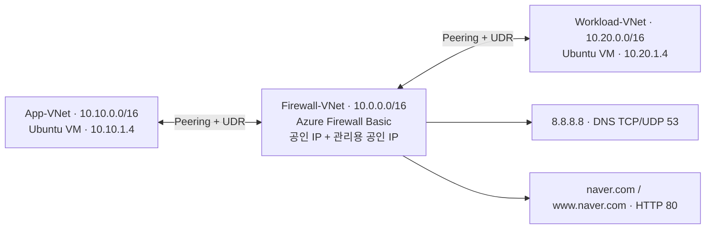

# Azure Firewall Hub-and-Spoke 실습

East US에 Azure Firewall Basic과 **Standard_D2s_v7 / Ubuntu 24.04 LTS VM 2대**를 배포합니다. 각 VM은 별도 VNet에 있으며, 인터넷 및 다른 Spoke로 가는 트래픽은 중앙 방화벽을 경유합니다.



## 허용 정책

| 출발지 | 목적지 | 허용 통신 |
|---|---|---|
| 양쪽 VM 서브넷 | `8.8.8.8` | DNS TCP/UDP 53 |
| 양쪽 VM 서브넷 | `naver.com`, `www.naver.com` | HTTP TCP 80 |
| 양쪽 VM 서브넷 | 반대편 VM 서브넷 | ICMP |
| 선택한 관리자 공인 IPv4 `/32` | Firewall 공인 IP의 2221 / 2222 | App / Workload VM의 SSH 22로 DNAT; 기본값 비활성 |

나머지는 방화벽 기본 거부 정책으로 차단합니다. HTTP 도메인은 애플리케이션 규칙으로 검사하며, 전체 인터넷 TCP 80 허용 규칙은 넣지 않습니다.

**인터넷 ping 제한:** Azure Firewall은 공인 IP로 SNAT하는 인터넷 방향 ICMP를 지원하지 않습니다. 따라서 `ping 8.8.8.8` 성공을 보장하는 구성은 아니며, ICMP 실습은 양쪽 VM 간 ping으로 대체합니다. [Microsoft 제한 사항](https://learn.microsoft.com/en-us/troubleshoot/azure/firewall/firewall-known-issues)

**HTTP와 HTTPS:** Naver가 HTTP 응답으로 HTTPS 주소를 안내할 수 있습니다. HTTP 응답(예: 301/302)을 받으면 HTTP 허용 검증은 성공입니다. `curl -L`로 HTTPS까지 따라가거나 브라우저에서 완성된 홈페이지를 보는 것은 이 HTTP-only 정책의 범위가 아닙니다. HTTPS 443이나 다른 도메인은 자동으로 허용하지 않습니다.

## 네트워크 설계

- Firewall-VNet의 `AzureFirewallSubnet`: `10.0.0.0/26`.
- Basic 필수 관리망 `AzureFirewallManagementSubnet`: `10.0.1.0/26`. 데이터용과 관리용 Standard 공인 IP를 각각 생성합니다.
- App VM 서브넷 `10.10.1.0/24`, Workload VM 서브넷 `10.20.1.0/24`.
- Hub ↔ 각 Spoke의 양방향 피어링 4개. Spoke 간 직접 피어링은 없습니다.
- 각 VM 서브넷의 `0.0.0.0/0`과 반대편 VNet 주소 공간을 방화벽 내부 IP로 라우팅합니다.
- VM에는 공인 IP가 없고 서브넷의 기본 외부 연결도 비활성화합니다.
- Basic에는 DNS 프록시가 없으므로 Spoke VNet DNS를 `8.8.8.8`로 지정합니다. DNS도 UDR 및 방화벽 네트워크 규칙을 거칩니다.
- Azure 기본 DNS는 UDR을 우회할 수 있으므로 NSG에서 `AzurePlatformDNS`를 별도로 거부합니다. 이 특수 서비스 태그는 Azure API에서 포트 `*`를 요구합니다. Azure VM 플랫폼 관리 통신과 메타데이터는 일반 인터넷 통신과 구별됩니다.
- VM의 패키지 설치·업데이트를 위한 광범위한 외부 허용 규칙은 없습니다.

## 사전 조건

- Terraform 1.7 이상, Azure CLI, Git, OpenSSH.
- East US `StandardDsv7Family`와 전체 지역 vCPU에 각각 **4 vCPU 이상**의 잔여 할당량.
- Standard 공인 IPv4 2개와 Firewall Basic을 생성할 수 있는 구독.
- 기존 SSH 공개키. 개인키는 Terraform에 넣지 않습니다.

할당량과 SKU 가용성은 구독 및 시점별로 달라집니다. `D2s_v7` 생성이 제한되는 경우 자동으로 다른 VM으로 바꾸지 말고 실제 제한을 확인하세요.

## 배포 (PowerShell)

```powershell
az login
az account set --subscription '<subscription-id>'
Copy-Item terraform.tfvars.example terraform.tfvars
```

`terraform.tfvars`에 구독 ID와 SSH **공개키 문자열**을 입력하세요. 관리자 SSH 접속이 필요하면 `management_source_cidr`에 현재 공인 IPv4의 `/32`를 지정합니다. 기본값 `null`이면 SSH DNAT를 만들지 않습니다.

```powershell
terraform init
terraform fmt -check -recursive
terraform validate
terraform test
terraform plan '-out=lab.tfplan'
terraform apply lab.tfplan
terraform output
```

`terraform test`는 모의 Azure 공급자를 사용하며 실제 Azure 리소스를 생성하지 않습니다. `terraform apply`는 과금 리소스를 생성합니다. 저장소의 공급자 잠금 파일을 유지해 같은 버전을 사용하세요.

## 접속 및 통신 테스트

관리자 `/32`를 활성화한 경우 방화벽 공인 IP의 2221번은 App VM, 2222번은 Workload VM에 연결됩니다. 아래 `$key`는 해당 공개키와 짝인 개인키 경로입니다.

```powershell
$fw = terraform output -raw firewall_public_ip
$key = "$HOME/.ssh/my-key"
ssh -i $key -p 2221 "azureuser@$fw"
# App VM에서: ping -c 3 10.20.1.4
# Workload VM에서: ping -c 3 10.10.1.4
```

저장소에 포함된 테스트를 양쪽 VM에 전송해 실행합니다.

```powershell
scp -i $key -P 2221 scripts/test-connectivity.sh "azureuser@${fw}:/tmp/test-connectivity.sh"
ssh -i $key -p 2221 "azureuser@$fw" 'bash /tmp/test-connectivity.sh 10.20.1.4'
scp -i $key -P 2222 scripts/test-connectivity.sh "azureuser@${fw}:/tmp/test-connectivity.sh"
ssh -i $key -p 2222 "azureuser@$fw" 'bash /tmp/test-connectivity.sh 10.10.1.4'
```

테스트는 UDP/TCP DNS, 시스템 이름 해석, 양방향 ICMP, Naver HTTP와 함께 비허용 도메인·HTTPS·다른 DNS·Spoke 간 SSH 차단을 확인합니다. `RESULT failures=0`과 종료 코드 0을 확인하세요. 인터넷 ICMP 실패는 문서화된 서비스 제한이며 성공 조건에 포함하지 않습니다.

Azure NIC의 **Effective routes**에서 기본 경로와 반대편 VNet 경로의 다음 홉이 `VirtualAppliance` 및 Firewall 내부 IP인지 확인하세요. 각 피어링은 `Connected`여야 합니다.

관리자 공인 IP가 바뀌면 `/32` 입력을 갱신해 `terraform apply`를 실행합니다. 테스트 후 외부 SSH 접속을 닫으려면 `management_source_cidr = null`로 바꾸고 적용합니다.

## 비용과 삭제

Firewall Basic, VM 2대, 디스크, 공인 IP와 네트워크 사용량에 비용이 발생합니다. VM만 종료해도 Firewall 등의 비용은 계속 발생합니다.

```powershell
terraform plan -destroy
terraform destroy
```

Terraform 상태 파일이 있는 동일한 작업 디렉터리에서 정리하세요. 이미 배포한 환경을 다른 디렉터리에서 새 상태로 다시 적용하면 중복 리소스가 생길 수 있습니다. `.tfstate`, `.tfvars`, 저장된 plan, 개인키와 실측 로그는 Git에 올리지 않습니다. 팀 공동 사용 시에는 상태 파일을 별도 Azure Storage backend로 옮기세요.
